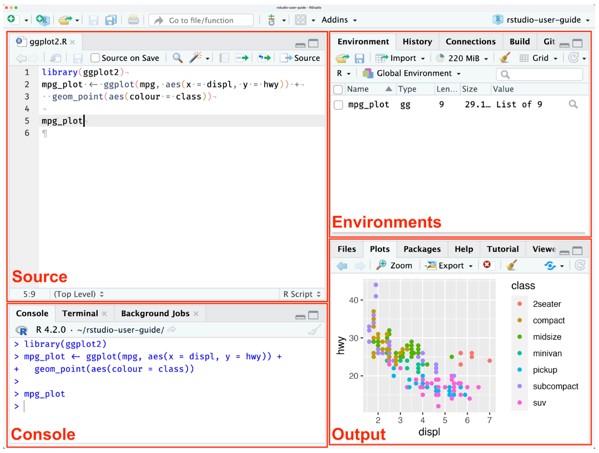

# Background  

R is a programming language as well as a software that runs R codes for carrying out statistical computing and graphics.  

Why is it widely used by researchers?  

- It is great for reproducibility as you can share your code  
- It has a lot of packages to analyze different kinds of data sets   
- It produces publication quality graphics  
- It is free and open source with regular community feedback  

Since it is widely used by the research community, you get real time feedback from an experienced user in a reasonable time. 


## Syntax in R
Like every programming language, we know how to talk with R via the script editor or the console. Here are the main components of R syntax:  

- the comments (#) and how they are used to document content  
- variables and functions  
- the assignment operator <-  
- the = for arguments in functions  

The basis of programming is that we write down instructions for the computer to follow, and then we tell the computer to follow those instructions. We write these instructions in the form of code, which is a common language that is understood by the computer and humans (after some practice). We call these instructions commands, and we tell the computer to follow the instructions by running (also called executing) the commands.  

## Console vs. script  
You can run commands directly in the R console, or you can write them into an R script. It may help to think of working in the console vs. working in a script as something like cooking. The console is like making up a new recipe, but not writing anything down. You can carry out a series of steps and produce a nice, tasty dish at the end. However, because you didn’t write anything down, it’s harder to figure out exactly what you did, and in what order.  

Writing a script is like taking nice notes while cooking- you can tweak and edit the recipe all you want, you can come back in 6 months and try it again, and you don’t have to try to remember what went well and what didn’t. It’s actually even easier than cooking, since you can hit one button and the computer “cooks” the whole recipe for you!  

An additional benefit of scripts is that you can leave comments for yourself or others to read. Lines that start with # are considered comments and will not be interpreted as R code.  

### Console  
- The R console is where code is run/executed  
- The prompt, which is the > symbol, is where you can type commands  
- By pressing Enter, R will execute those commands and print the result.  
- You can work here, and your history is saved in the History pane, but you can’t access it in the future. 

### Script
- A script is a record of commands to send to R, preserved in a plain text file with a .R extension
- You can make a new R script by clicking File → New File → R Script, clicking the green + button in the top left corner of RStudio, or pressing Shift+Cmd+N (Mac) or Shift+Ctrl+N (Windows). It will be unsaved, and called “Untitled1”  
- If you type out lines of R code in a script, you can send them to the R console to be evaluated
  - Cmd+Enter (Mac) or Ctrl+Enter (Windows) will run the line of code that your cursor is on
  - If you highlight multiple lines of code, you can run all of them by pressing Cmd+Enter (Mac) or Ctrl+Enter (Windows)
  - By preserving commands in a script, you can edit and rerun them quickly, save them for later, and share them with others
  - You can leave comments for yourself by starting a line with a #
  
# Setup guide:
## R studio  

What would you need?  

- Stable internet connection  
- Disk space ~5GB  
- R and RStudio  

::: {.callout-note appearance="simple"}
Start by downloading latest version of R using this link: R version 4.6.1 (Happy Hop) needs takes >1min  

Then download [RStudio](https://docs.posit.co/ide/user/#rstudio-ide-oss-downloads?ref=rstudio-legacy) using this link and choose the appropriate open-source version for Windows/Mac/Linux needs >1min  
:::  

## Using R  

RStudio is an integrated development environment (IDE) designed to improve productivity in data anaylsis.  

When you start RStudio, you’ll see four key regions or “panes” in the interface:  

-	**Source pane** – where you can edit and save R or Python scripts or author computational documents like Quarto and R Markdown.
-	**Console pane** – to write short interactive R commands
-	**Environment pane** – displays temporary R objects as created during that R session.
-	**Output Pane** – displays the plots, tables, or HTML outputs of executed code along with files saved to disk  

    

# Working on the dataset  

We begin with downloading the dataset we will be working with:  

In console, type the following  

## Downloading the file  

1. Download the data: [gapminder_data.csv](/Data/gapminder_data.csv)  

2. Alternatively you can use this command to get it going directly   

::: {.column-body}

```{r}
#| eval: true  

gapminder <- read.csv("https://raw.githubusercontent.com/swcarpentry/r-novice-gapminder/main/episodes/data/gapminder_data.csv")

```
:::  


The first thing we should always do is check out what the data looks like.

## Types of data in R  

It’s important to understand how R thinks about, represents, and stores data.  

- Data frame  
  - Data.frames are made up of vectors. A vector is a 1-dimensional series of values, each column in a data.frame is a vector. Vectors are the basic building blocks of all data in R. Basically, in R, a bunch of vectors are stitched together in some way, or a function so understanding how vectors work is crucial to understanding how R treats data.  
  
- Meta data  
  - Metadata is a file in which we identify information about the data which is also stored in a CSV file format. In this file, each row corresponds to a sample and each column contains some information about each sample.  

One of the great things about R is how it handles missing data, undefined or infinite data represented as NA, NaN or Inf, without quotes, in vectors of any type.  

### Vectors  

There are 4 main types of vectors (also known as atomic vectors):  

- "character" for strings of characters. Each entry in a character vector is wrapped in quotes. In other programming languages, this type of data may be referred to as "strings".  
-	"integer" for integers. You may sometimes see integers represented like 2L or 20L. The L indicates to R that it is an integer, instead of "numeric".  
-	"numeric", aka "double", vectors can contain numbers including decimals. Other languages may refer to these as “float” or “floating point” numbers.  
-	"logical" for TRUE and FALSE, which can also be represented as T and F. In other programming languages, these may be referred to as “Boolean” data.
Vectors can only be of a single type. Mixing up vector types is one of the most common mistakes in R, and it can be tricky to figure out. Thus, it’s often very useful to check the types of vectors.  

### Manipulation of vectors 

- Matrices and arrays  
  -	n-dimensional numeric representations
  -	many-dimensional numeric  
  
- lists  
  - lists are very flexible ways to store vectors  
  - list can contain vectors of many different types and lengths  
  - an entry in a list can be another list, so lists can get deeply nested  
  - a data.frame is a type of list where each column is an individual vector and each vector has to be the same length, since a data.frame has an entry in every column for each row  
  
- factors  
  - a way to represent categorical data
  - they can be ordered or unordered
  - they often look like character vectors, but behave differently
  - under the hood, they are integers with character labels, called levels, for each integer  
  - they come in handy when you are plotting categorical data and want to control the ordering of categories in the plot  . 

We could use str() function to examine the structure of the data. str() will tell us how many observations/rows (obs) and variables/columns we have, as well as some information about each of the variables. We could also look at the data using summary() function. For data frames, summary yields a numeric, tabular, or descriptive summary of each column. Numeric or integer columns are described by the descriptive statistics (quartiles and mean), and character columns by its length, class, and mode.  

### Back to gapminder dataset - what does the data looks like?  
```{r}
#| eval: false
#| echo: true
#| warnings: false  

str(gapminder)  
summary(gapminder)  
typeof(gapminder)  
length(gapminder)  
```

Evaluating the number of rows and columns in our data 
```{r}
#| eval: true
#| echo: true
#| warnings: false


nrow(gapminder)  
ncol(gapminder) 
```


Alternatively you could use dim() function to display both no. of rows and columns  
```{r}
#| eval: true
#| echo: true
#| warnings: false


dim(gapminder)  
```  

You could then explore the columns in your data using the colnames() function to know the variables in your data  

```{r}
#| eval: true
#| echo: true
#| warnings: false  


colnames(gapminder)

```

### what do the individual vectors looks like?  

```{r}
#| eval: true
#| echo: true
#| warnings: false


typeof(gapminder$year)  

```
  
Similarly, you could check it for other columns as well.

You could also use head() and tail() function to see first few rows and last few rows respectively.  

Once we know enough about the data, we can move on to analyzing and visualizing the data. When analyzing data, we often work with selected data to answer a particular scientific question, so we are only working with selected columns or rows.  

# Plotting the data  

There are various packages available in R that can be downloaded from various repositories. They include a collections of R functions, data, and compiled code in a well-defined format, created to add specific functionality. They can either be base packages or user contributed packages. Standard (or base) packages are considered part of the R source code and automatically available as part of your R installation. These contain the basic functions that allow R to work and enable standard statistical and graphical functions on datasets. The directories in R where the packages are stored are called the libraries. ggplot is one such base package that we would be downloading from CRAN repository here to plot our data.  

### Installing the ggplot package 

```{r}
#| eval: true
#| echo: true
#| warnings: false

install.packages("ggplot2", repos = "https://cloud.r-project.org")

```  

ggplot2 is built from the following set of components:  

- Data sets are the data that you, the user, provide.  
- Mapping aesthetics are what connect the data to the graphics where you choose the graph looks using various available options.  
- Layers are the actual graphical output from ggplot2.  

### Plotting a portion of data – Life expectancy vs GDP per capita  

Here, we are asking ggplot function to plot gapminder data using the columns Life expectancy and GDP per capita  

```{r}
#| eval: true
#| echo: true
#| warnings: false

library("ggplot2")
ggplot(data = gapminder, mapping = aes(x = gdpPercap, y = lifeExp)) + geom_point()

```  

### Modifying the figure 

We can plot linear relationship between the Life expectancy and GDP per capita  

```{r}
#| eval: true
#| echo: true
#| warnings: false

ggplot(data = gapminder, mapping = aes(x = gdpPercap, y = lifeExp)) +
  geom_point(alpha = 0.5) + scale_x_log10() + geom_smooth(method="lm")

```  

::: {.callout-note appearance="simple"}  

Now you could try creating a similar plot for year vs GDP per capita  

:::  
